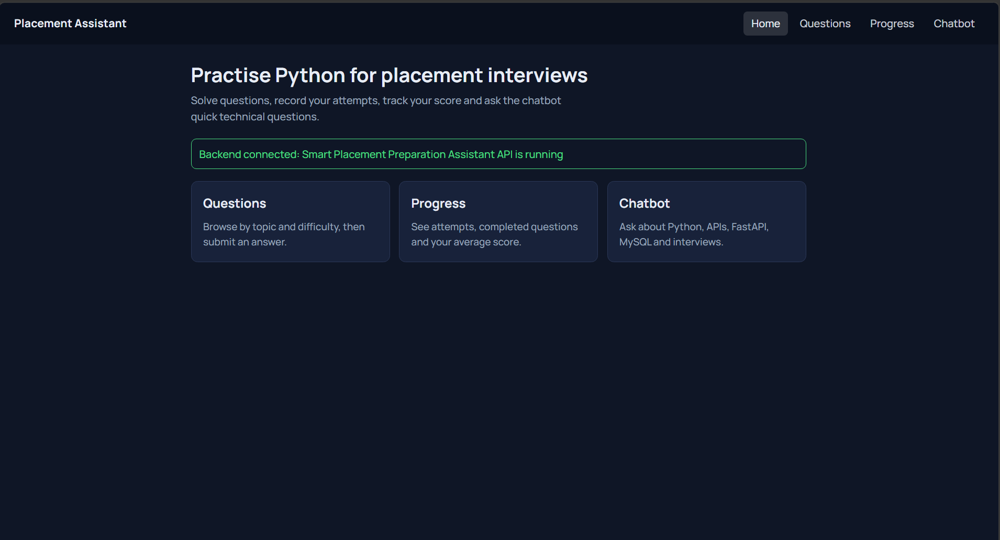
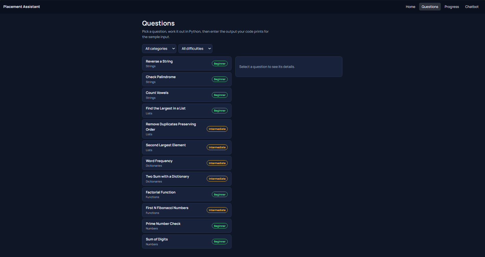
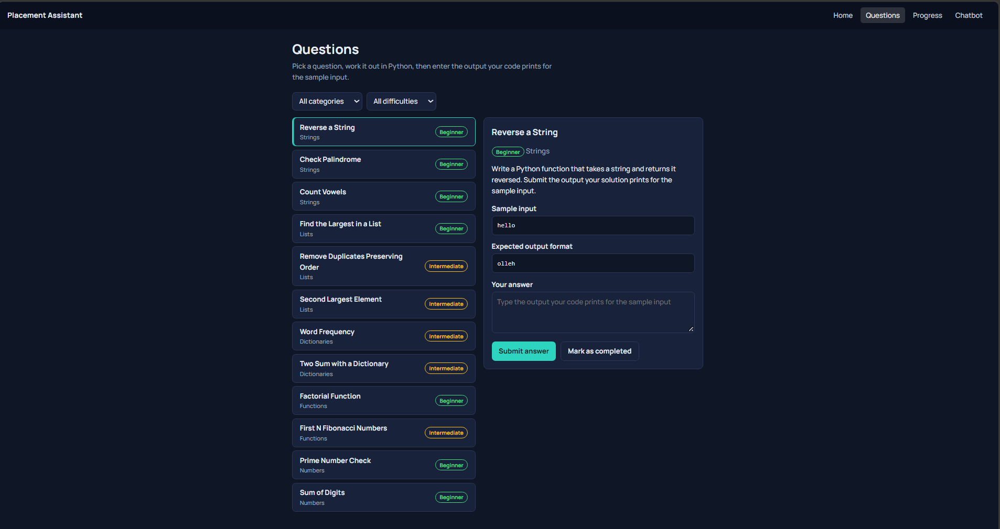
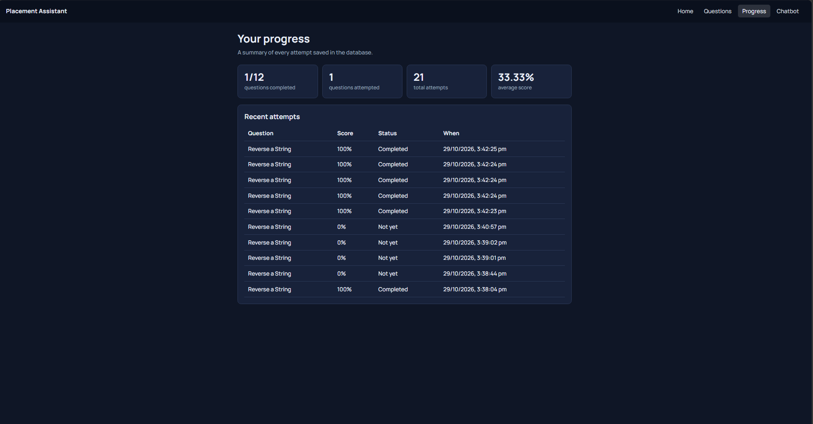
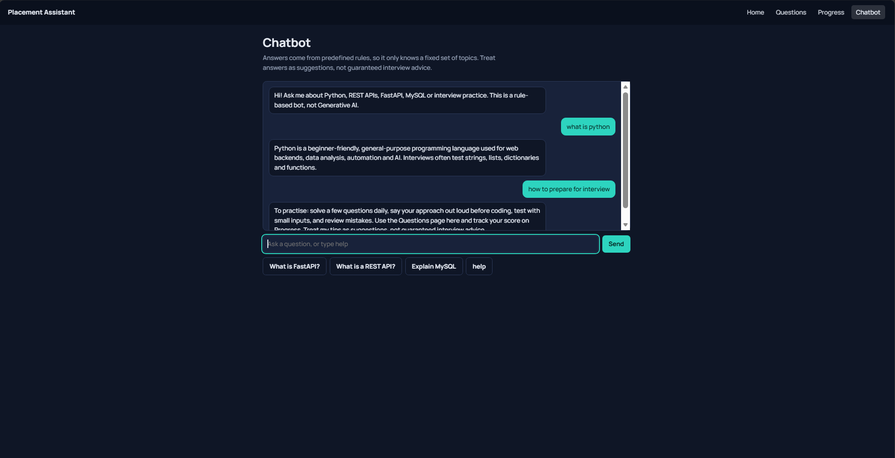

# Smart Placement Preparation Assistant

**College / Department:** Dayananda Sagar College of Engineering, Department of CSE

**Team:** T G Sanika, Vidya M, Prerana K M, Suguna

## Objective
To build a web application that helps engineering students prepare for technical placement interviews by practising Python questions, recording attempts, tracking progress and asking a rule-based chatbot basic technical questions.

**Stack:** HTML/CSS/JavaScript (Fetch API) -> FastAPI + Pydantic -> MySQL. The chatbot is rule-based (keyword matching). It is **not** Generative AI.

## Features
- Question list with category and difficulty, plus filters
- Question detail with description, sample input and expected output format
- Submit an answer (auto-checked) or mark a question as completed
- Attempts and scores stored in MySQL; progress page with summary and recent attempts
- Rule-based chatbot through `POST /chat`
- Friendly messages for empty input, missing records, failed requests and a stopped backend

## Setup
Requirements: Python 3.10+, MySQL 8, a browser.

```bash
# 1. Database (run from the project root folder)
mysql -u root -p < database/schema.sql

# 2. Backend (run these inside the backend folder)
cd backend
python -m venv venv
venv\Scripts\activate            # Windows. macOS/Linux: source venv/bin/activate
pip install -r requirements.txt
copy .env.example .env           # Windows. macOS/Linux: cp .env.example .env
uvicorn main:app --reload
```

After copying, open `backend/.env` and replace `DB_PASSWORD` with your own MySQL password. `uvicorn` must be run from inside `backend/`, otherwise it cannot find `main.py`.

If `mysql ... < database/schema.sql` does not work in PowerShell, open the MySQL command line and run `SOURCE database/schema.sql;`, or open the file in MySQL Workbench and run it.

- API docs: http://127.0.0.1:8000/docs
- App: http://127.0.0.1:8000/app/ (the backend also serves the frontend), or open `frontend/index.html` / run `python -m http.server 5500` inside `frontend/`.

**Security:** never commit `.env` (it is listed in `.gitignore`) and never show passwords or keys in screenshots or this README.

## Screenshots
Add the four screenshots to the `screenshots/` folder and change the file names below if yours differ.

| Page | Screenshot |
|---|---|
| Question list |  |
| Question list |  |
| Question detail |  |
| Progress page |  |
| Chatbot |  |

## API endpoints
| Method | Endpoint | Body | Success | Errors |
|---|---|---|---|---|
| GET | `/` | none | `200 {"status":"ok",...}` | none |
| GET | `/questions?category=&difficulty=` | none | `200` list of questions | `503` DB down |
| GET | `/questions/{id}` | none | `200` one question | `404` not found, `422` bad id |
| POST | `/questions` | `{title, category, difficulty, description, sample_input, expected_output}` | `201` new question | `422` invalid |
| POST | `/attempts` | `{student_id, question_id, submitted_answer?, completed?}` | `201 {attempt_id, score, completed, message}` | `404` unknown student/question, `422` no answer and not completed |
| GET | `/students/{id}/progress` | none | `200` counts, average score, recent attempts | `404` unknown student |
| POST | `/chat` | `{"message": "What is FastAPI?"}` | `200 {reply, matched_topic}` | `422` empty message |

Sample: `POST /attempts` with `{"student_id":1,"question_id":1,"submitted_answer":"olleh"}` returns `{"attempt_id":1,"score":100.0,"completed":true,"message":"Correct! Well done."}`.

## Scoring rule
A typed answer is compared with `expected_output` (case and extra spaces ignored): match = 100, otherwise 0. "Mark as completed" with no answer is self-reported and scores 100.

## Database design
- `students` (one demo student seeded), `questions` (12 seeded), `attempts` (links students and questions with foreign keys).
- `attempts` is a separate table because one student can attempt a question many times (one-to-many from both sides). All SQL uses `%s` parameters.

## Chatbot and Generative AI
`backend/chatbot.py` checks the message for whole-word keywords and returns a predefined reply; otherwise it says it has no predefined answer. An LLM could later replace `get_reply()` with a backend API call (key kept in `.env`), and the `/chat` endpoint and frontend would not change. An LLM generates new text from a trained model, whereas this bot can only return fixed text.

## Known limitations
- No login: uses seeded demo student ID 1.
- Answers are matched to the expected output text; the app does not run student code.
- Chatbot knows only the fixed topics. CORS is open for local development only.

## Team contributions
| Member | Role | Work done |
|---|---|---|
| Vidya M | Backend | FastAPI endpoints, Python logic and scoring rule, Pydantic validation, HTTP error handling |
| Prerana K M | Database | MySQL schema, sample data, parameterized SQL queries, storing attempts |
| T G Sanika | Frontend | HTML/CSS pages, JavaScript, Fetch API integration, loading and error messages |
| Suguna | Chatbot and QA | Rule-based chatbot, integration testing, screenshots, documentation |

Every team member can explain the full application.

## Testing checklist
Tick these after running them (screenshots go in `screenshots/`):
- [ ] Backend starts and `/docs` opens
- [ ] `GET /questions` returns 12 questions
- [ ] `GET /questions/999` returns 404
- [ ] A valid attempt is saved and shows on the progress page after refresh
- [ ] Frontend shows real data from FastAPI
- [ ] Chatbot answers known keywords and handles unknown text
- [ ] Empty answer / empty chat message is handled politely
- [ ] Stopping the backend shows an error message in the page
- [ ] Stopping MySQL returns 503, not a crash
- [ ] No secrets in the repo or screenshots
